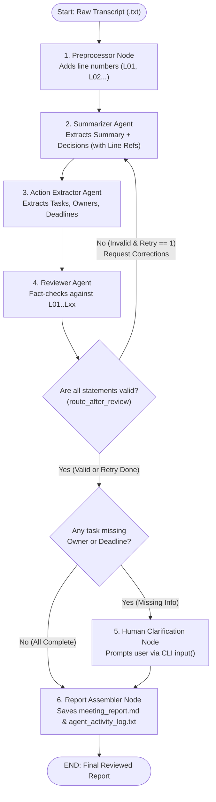
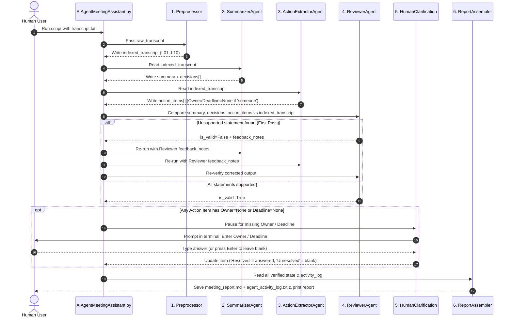
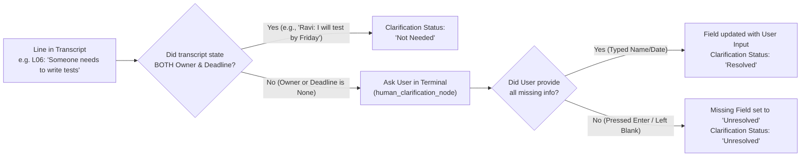

# Multi-Agent AI Meeting Assistant

A **LangGraph-based Multi-Agent System** that reads a raw meeting transcript with speaker names, extracts an executive summary, key decisions, and action items with exact line citations (`L01`, `L02`...), fact-checks its own work against hallucinations, asks a human to clarify missing owners/deadlines, and produces a reviewed report (`meeting_report.md`) plus an audit trail (`agent_activity_log.txt`).

---

## Part 1: Presentation Deck Outline (Google Slides Ready)

### Slide 1: Problem & Objective
- **The Problem:** Meeting notes often miss action items, invent owners/deadlines (AI hallucinations), or leave vague tasks (`"someone should review security"`) untracked.
- **Our Solution:** A **6-Stage Multi-Agent Assembly Line** built with **LangGraph** that:
  1. Summarizes discussions & decisions with exact transcript line citations (`L01`, `L02`...).
  2. Extracts action items, owners, and deadlines from speaker labels (`Ravi: I will...`).
  3. **Fact-checks** extracted data before final output (Review & Correction loop).
  4. Uses **Human-in-the-Loop (HITL)** to clarify missing owners/deadlines instead of guessing.

### Slide 2: Tools & Technology Stack Used
| Tool / Library | Role in Project | Layman Analogy |
| :--- | :--- | :--- |
| **Python 3.12** | Core programming language | The factory building |
| **LangGraph** (`StateGraph`) | Multi-agent orchestration, routing & loops | The **Factory Floor Map & Traffic Controller** |
| **LangChain** (`ChatOpenAI`, Prompts) | Connects prompts to the AI model | The **Walkie-Talkie** to talk to the AI brain |
| **OpenRouter (`gpt-4o-mini`)** | LLM with `temperature=0.0` for strict factual output | The **AI Specialist Brains** |
| **Pydantic** (`BaseModel`) | Strict structured output schemas (`state.py`) | **Printed Paper Forms** so AI never rambles |
| **Tabulate** | Formats lists into clean GitHub Markdown tables | The **Typesetter / Formatter** |

### Slide 3: How the 6 Agents Work Together
1. **Preprocessor (`preprocessor_node`):** Pure Python step that adds line numbers (`L01`, `L02`...) so every decision and task has a verifiable citation.
2. **Summarizer Agent (`summarizer_node`):** Writes the executive summary and extracts group decisions with line references.
3. **Action Extractor Agent (`action_extractor_node`):** Identifies tasks, maps `"I will..."` statements to the speaker's name, preserves exact deadlines, and flags `"someone"` tasks as `None` (`Unresolved`).
4. **Reviewer Agent (`reviewer_node`):** Audits the summary, decisions, and tasks against the transcript. Flags unsupported claims and triggers at most **1 correction pass**.
5. **Human Clarification (`human_clarification_node`):** Pauses in the terminal (`input()`) to ask the user for any missing owner or deadline. Marks answered items as `Resolved` and blank answers as `Unresolved`.
6. **Report Assembler (`report_assembler_node`):** Exports `meeting_report.md` and `agent_activity_log.txt`.

### Slide 4: Key Design Decisions Taken
- **Decision 1 — Why Pre-Index Lines (`L01`, `L02`) in Python?**
  LLMs are bad at counting lines on their own. Numbering lines in Python first guarantees 100% accurate line citations.
- **Decision 2 — Why Put Reviewer *Before* Human Clarification?**
  If the Reviewer ran *after* human input, it might mistake user-supplied names (not in the transcript) for AI hallucinations—or worse, loop back and force the human to type answers twice! Running Reviewer first verifies the AI's work once, then asks the human once.
- **Decision 3 — Why Cap Correction Loops at 1 Retry (`retry_count <= 1`)?**
  Prevents infinite AI loops and wasted API calls while still fulfilling the review-and-correction requirement.
- **Decision 4 — Strict Anti-Hallucination Rules (`temperature=0.0` + Pydantic):**
  Forces the AI to keep exact deadline phrases (`"Friday"`, `"tonight 8 PM"`) instead of inventing calendar dates, and never guess when a transcript says `"someone"`.

### Slide 5: Expected Deliverables & Live Demo Transition
- **Deliverable 1 (`meeting_report.md`):** Executive Summary, Decisions Table, Action Items Table (`Owner`, `Deadline`, `Clarification Status`, `Line Ref`), Review Verdict, and Brief Agent Activity Log.
- **Deliverable 2 (`agent_activity_log.txt`):** Timestamped step-by-step audit trail showing which agent performed each task.

---

## Part 2: Visual Flow Diagrams (To Understand the Process Easily)

### 1. High-Level Workflow Diagram (The Assembly Line)
Think of the system as a single **Shared Clipboard (`MeetingState`)** passed from station to station:



---

### 2. Step-by-Step Sequence Diagram (How Data Moves on the Shared Clipboard)
This diagram shows **who reads what** and **who writes what** at every step:



---

### 3. How Owner & Deadline Clarification Status Works
This diagram shows how each task gets its `Clarification Status` in the final table:



---

## Part 3: Project Files & Code Map

| File | Layman Role | Key Functions / Classes |
| :--- | :--- | :--- |
| [`state.py`](file:///D:/Labs/AI/AiMeetingAssistant/state.py) | **The Shared Clipboard & Forms** | `MeetingState`, `Decision`, `ActionItem`, `ReviewFeedback`, `AgentLog` |
| [`nodes.py`](file:///D:/Labs/AI/AiMeetingAssistant/nodes.py) | **The 6 Specialist Workers** | `preprocessor_node`, `summarizer_node`, `action_extractor_node`, `reviewer_node`, `human_clarification_node`, `report_assembler_node` |
| [`graph.py`](file:///D:/Labs/AI/AiMeetingAssistant/graph.py) | **The Factory Floor Map** | `route_after_review`, `build_meeting_graph` |
| [`AIAgentMeetingAssistant.py`](file:///D:/Labs/AI/AiMeetingAssistant/AIAgentMeetingAssistant.py) | **The Main Start Button** | `load_transcript`, `main` (streams live execution & prints report + diagrams) |
| [`meeting_report.md`](file:///D:/Labs/AI/AiMeetingAssistant/meeting_report.md) | **Deliverable 1 (Final Report)** | Summary, Decisions, Action Items Table, Review Verdict, Brief Activity Log |
| [`agent_activity_log.txt`](file:///D:/Labs/AI/AiMeetingAssistant/agent_activity_log.txt) | **Deliverable 2 (Audit Trail)** | Chronological log of every agent action |

---

## Part 4: How to Run the Live Demo

### 1. Demo Case A — Happy Path (No Missing Info, No Human Prompt Needed)
```powershell
.\.venv\Scripts\python.exe AIAgentMeetingAssistant.py test_case_transcripts/tc_01_happy_path.txt
```
*What to point out:* Every task already has a speaker owner and deadline, so the graph skips `human_clarification` and goes straight from `reviewer` $\rightarrow$ `report_assembler`.

### 2. Demo Case B — Missing Owners/Deadlines (Shows Human-in-the-Loop Clarification)
```powershell
.\.venv\Scripts\python.exe AIAgentMeetingAssistant.py test_case_transcripts/tc_06_activity_log_verification.txt
```
*What to do during the demo:*
1. For **Task 2**, type an owner (e.g., `Krishna`) and a deadline (e.g., `Friday 5 PM`) $\rightarrow$ shows **`Resolved`** in the final table.
2. For **Task 3**, press `Enter` (leave blank) $\rightarrow$ shows **`Unresolved`** in the final table.
3. Open [`meeting_report.md`](file:///D:/Labs/AI/AiMeetingAssistant/meeting_report.md) and [`agent_activity_log.txt`](file:///D:/Labs/AI/AiMeetingAssistant/agent_activity_log.txt) to show the final output tables and agent audit log.
